# Activité 1
# I. Mise en place initiale
## 1. Environnement
- Machine physique : Windows 11, client SSH OpenSSH
- VM : Ubuntu 26.04 LTS sous VirtualBox
- Utilisateur de la VM : `ferid`
- Réseau de la VM : adaptateur 1 en accès par pont, IP `192.168.100.88`

## 2. Configuration côté VM
```bash
sudo apt update
sudo apt install openssh-server
systemctl status ssh        # doit afficher "active (running)"
ip a                        # pour relever l'adresse IP
```
### Capture 1 : service SSH actif dans la VM

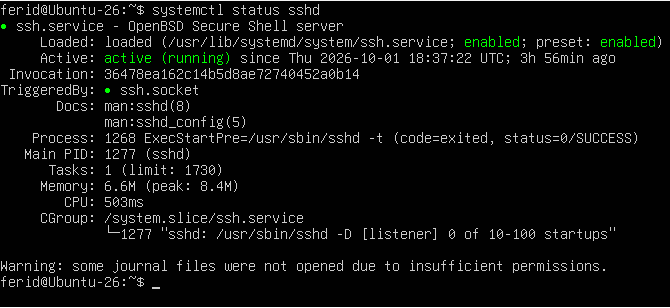

### Test depuis la machine physique
```powershell
ssh ferid@192.168.100.88
```
À la première connexion, l'empreinte du serveur est acceptée (`yes`) et
enregistrée dans `C:\Users\fersd\.ssh\known_hosts`.

### Capture 2 : connexion SSH réussie

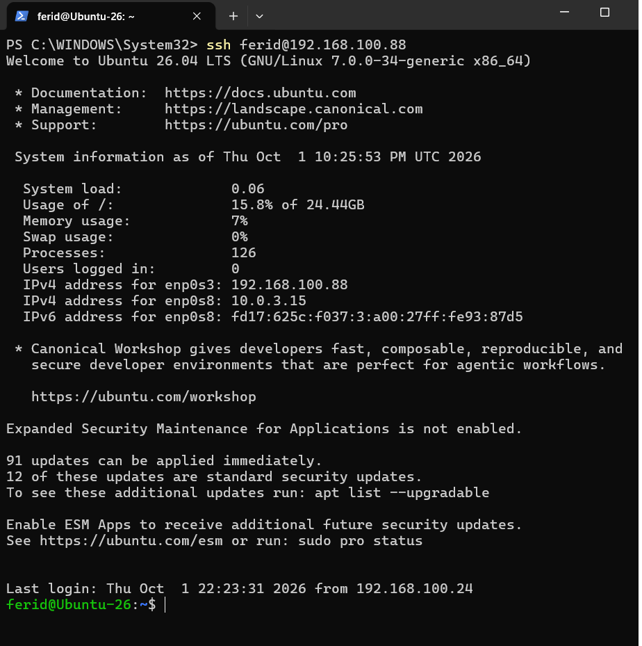

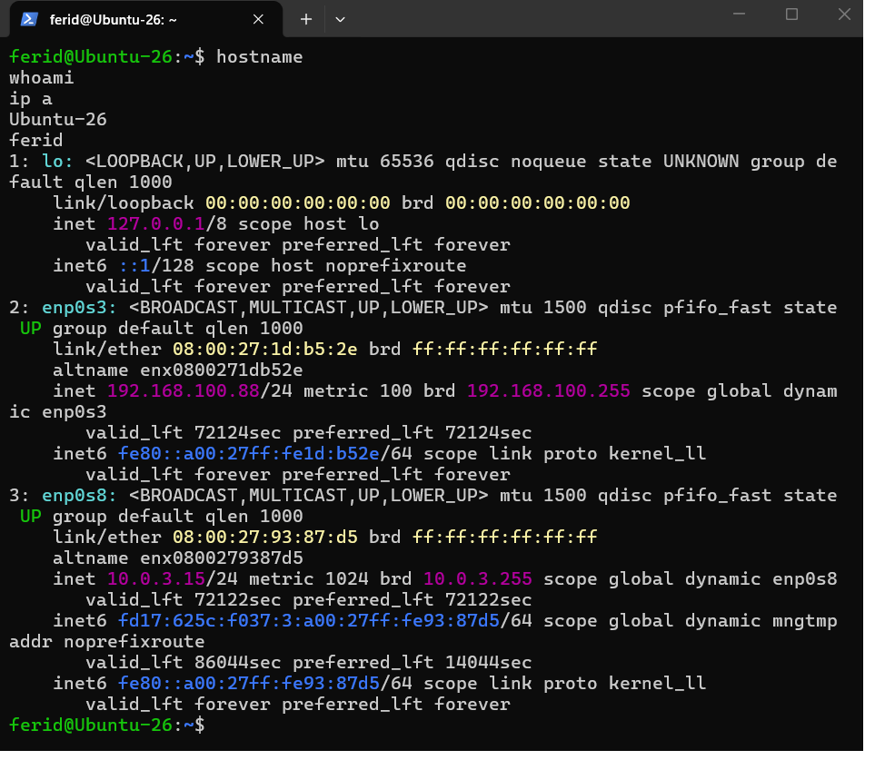


### Authentification par clé 
```powershell
ssh-keygen -t ed25519
scp $env:USERPROFILE\.ssh\id_ed25519.pub ferid@192.168.100.88:/tmp/key.pub
```
Dans la VM : ajout de la clé dans `~/.ssh/authorized_keys`
(droits : `chmod 700 ~/.ssh`, `chmod 600 ~/.ssh/authorized_keys`).

| Clé | Emplacement |
|---|---|
| Clé privée (client) | `C:\Users\<nom>\.ssh\id_ed25519` |
| Clé publique (client) | copiée dans `/home/ferid/.ssh/authorized_keys` (VM) |
| Clés du serveur | `/etc/ssh/ssh_host_*` (VM) |

## 3. Installation de Docker sur la VM

Méthode officielle : dépôt APT de Docker (Ubuntu 26.04 « resolute » est supporté).
Les commandes sont exécutées dans la VM (directement ou via SSH).

### 3.1. Supprimer les paquets susceptibles d'entrer en conflit

```bash
for pkg in docker.io docker-doc docker-compose docker-compose-v2 podman-docker containerd runc; do
  sudo apt remove -y $pkg
done
```

### 3.2. Ajouter le dépôt officiel Docker

```bash
sudo apt update
sudo apt install -y ca-certificates curl
sudo install -m 0755 -d /etc/apt/keyrings
sudo curl -fsSL https://download.docker.com/linux/ubuntu/gpg -o /etc/apt/keyrings/docker.asc
sudo chmod a+r /etc/apt/keyrings/docker.asc

sudo tee /etc/apt/sources.list.d/docker.sources <<EOF
Types: deb
URIs: https://download.docker.com/linux/ubuntu
Suites: $(. /etc/os-release && echo "${UBUNTU_CODENAME:-$VERSION_CODENAME}")
Components: stable
Architectures: $(dpkg --print-architecture)
Signed-By: /etc/apt/keyrings/docker.asc
EOF

sudo apt update
```

### 3.3. Installer Docker Engine

```bash
sudo apt install -y docker-ce docker-ce-cli containerd.io docker-buildx-plugin docker-compose-plugin
```

### 3.4. Vérifier l'installation

```bash
sudo systemctl status docker     # doit afficher "active (running)"


docker --version


```
#### Capture d'écran

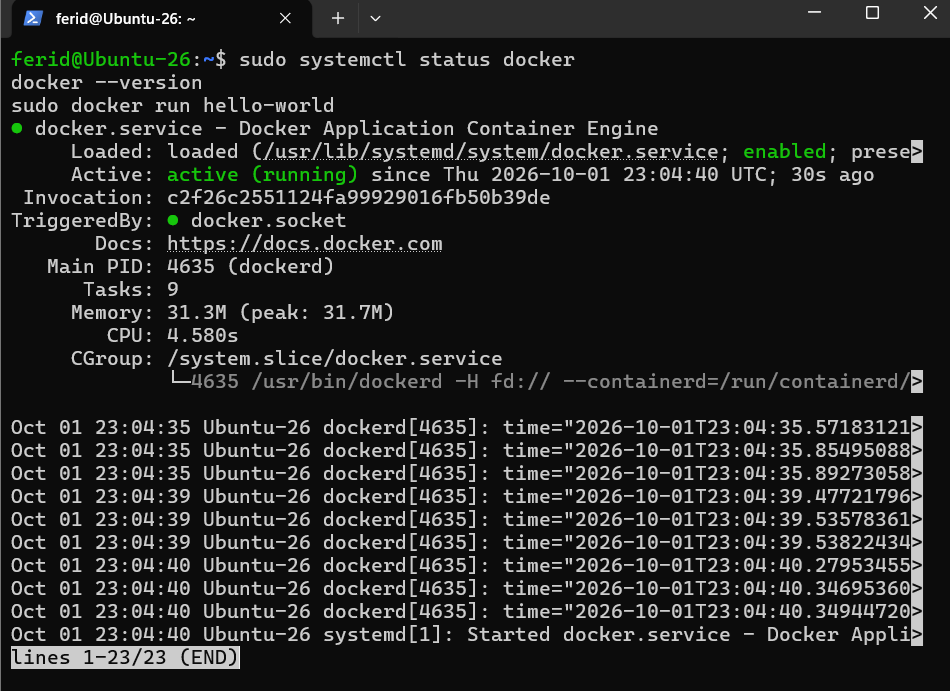

#### Capture d'écran

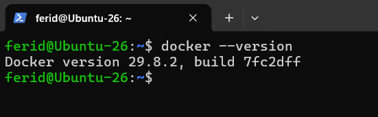


## 4. Installation de Jenkins en tant que service

Méthode officielle : dépôt APT de Jenkins (version LTS) avec OpenJDK 21.
Les commandes sont exécutées dans la VM (via SSH).

### 4.1. Installer Java 21

```bash
sudo apt update
sudo apt install -y fontconfig openjdk-21-jre
java -version
```

### 4.2. Ajouter le dépôt officiel Jenkins

```bash
sudo wget -O /etc/apt/keyrings/jenkins-keyring.asc \
  https://pkg.jenkins.io/debian-stable/jenkins.io-2026.key

echo "deb [signed-by=/etc/apt/keyrings/jenkins-keyring.asc] https://pkg.jenkins.io/debian-stable binary/" \
  | sudo tee /etc/apt/sources.list.d/jenkins.list > /dev/null

sudo apt update
```

### 4.3. Installer Jenkins

```bash
sudo apt install -y jenkins
```

### 4.4. Activer et démarrer le service

```bash
sudo systemctl enable --now jenkins
sudo systemctl status jenkins     # doit afficher "active (running)"
```
#### capture

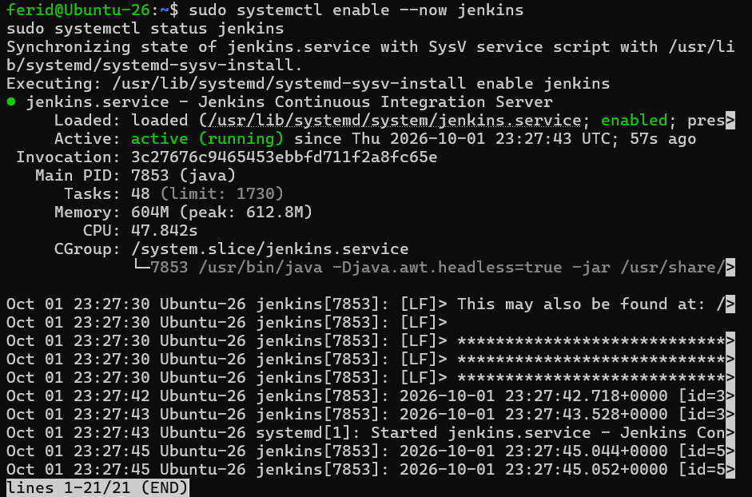
Le service démarre automatiquement au boot (`enable`) et écoute sur le port 8080.

### 4.5. Ouvrir le port 8080 (si le pare-feu UFW est actif)

```bash
sudo ufw status
sudo ufw allow 8080/tcp
```

### 4.6. Récupérer le mot de passe initial

```bash
sudo cat /var/lib/jenkins/secrets/initialAdminPassword
```

### 4.7. Vérification depuis la machine physique

Dans PowerShell sous Windows :

```powershell
Test-NetConnection 192.168.100.88 -Port 8080
```

Puis dans le navigateur Windows : `http://192.168.100.88:8080`

La page « Unlock Jenkins » s'affiche : saisir le mot de passe initial, puis
installer les plugins suggérés et créer l'administrateur.

#### Capture d'écran

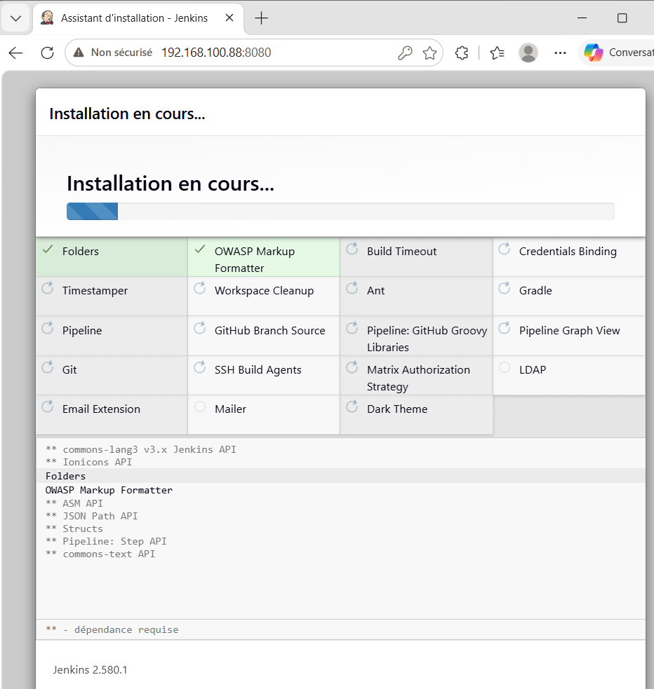

*La capture montre le navigateur Windows sur `http://192.168.100.88:8080`
affichant l'interface Jenkins.*

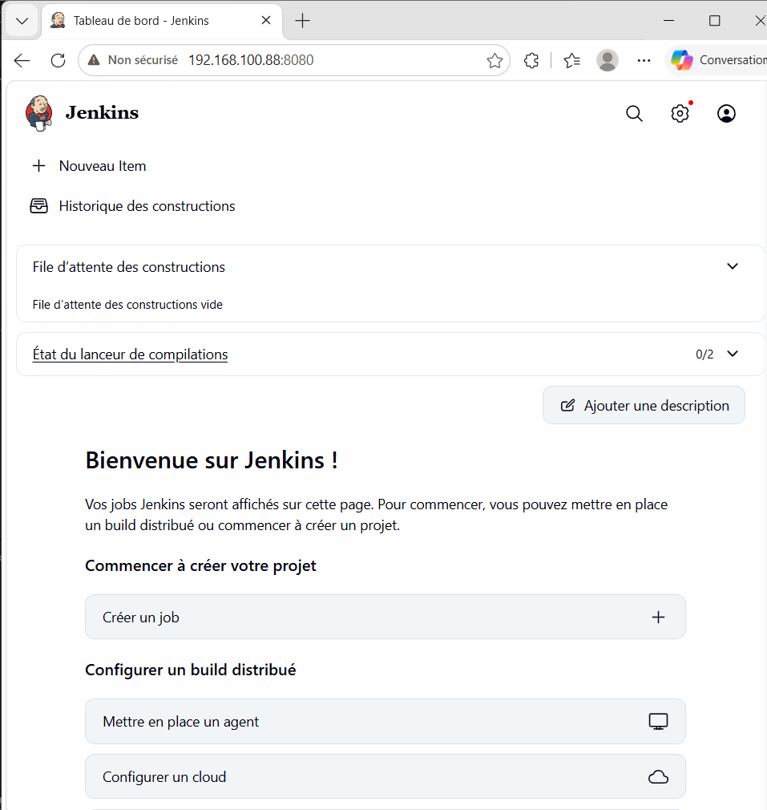


## 5. mini CV One Page 

https://github.com/ferid-saad/cv-ferid-saad

https://ferid-saad.github.io/cv-ferid-saad/

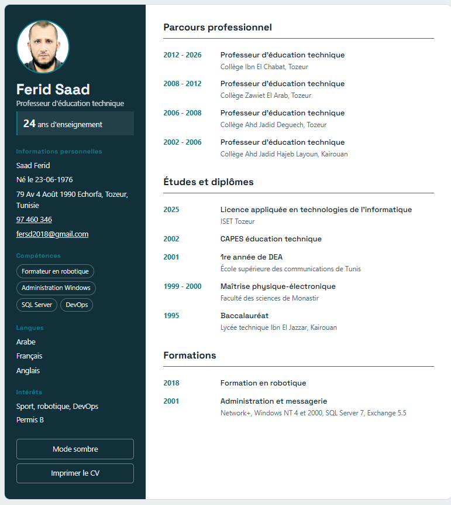


## 6. Configuration du push GitHub via SSH

1. Génération de la clé : `ssh-keygen -t ed25519 -C "fersd2018@gmail.com"`
2. Ajout de la clé publique dans GitHub (Settings → SSH and GPG keys → New SSH key)
3. Test de la connexion : `ssh -T git@github.com`
4. Passage du dépôt en SSH : `git remote set-url origin git@github.com:ferid-saad/cv-ferid-saad.git`

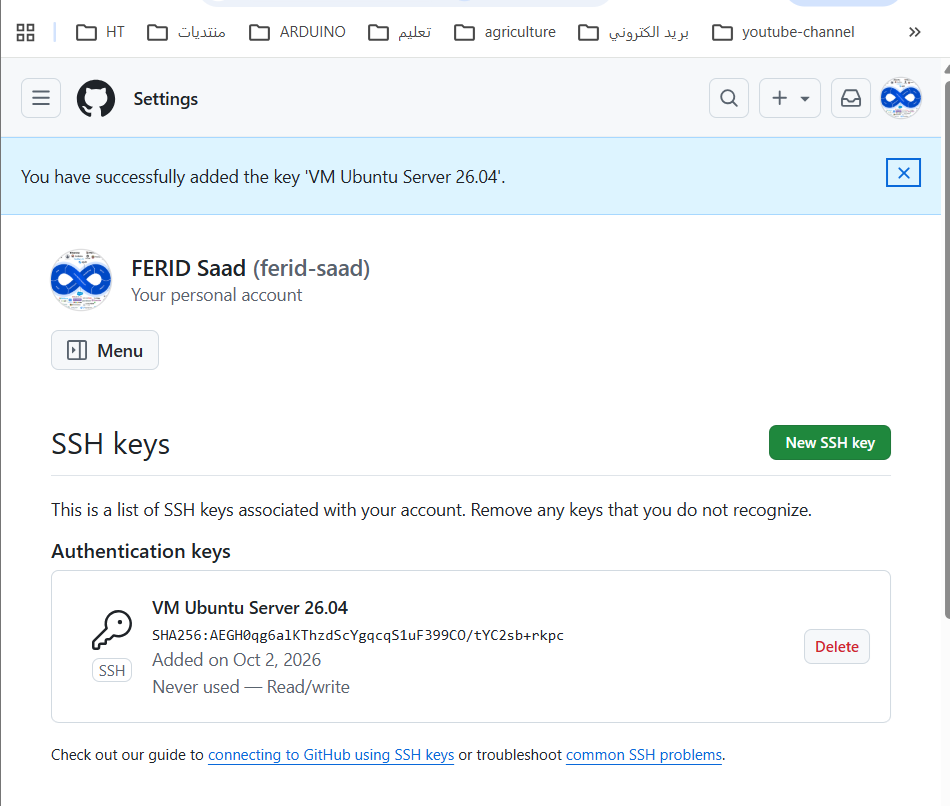


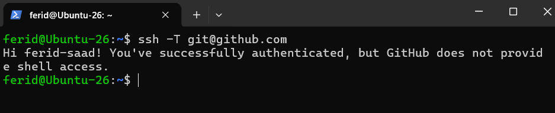


# II. Évolution du mini-CV vers DevSecOps Portfolio

## 7.DevSecOps Portfolio 


## 8. DevSecOps Skills

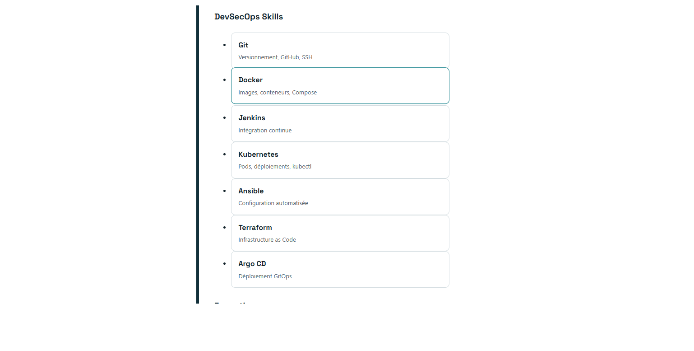

## 9. Section Projects générée dynamiquement en JavaScript

### capture

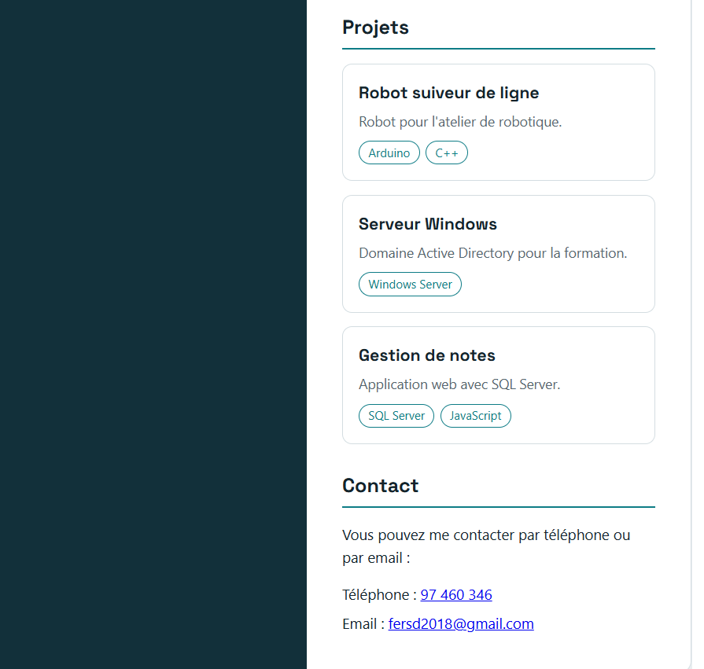

### code JavaScript 

````
// ===== Projets =====
const projects = [
  { title: "Robot suiveur de ligne", description: "Robot pour l'atelier de robotique.", tags: ["Arduino", "C++"] },
  { title: "Serveur Windows", description: "Domaine Active Directory pour la formation.", tags: ["Windows Server"] },
  { title: "Gestion de notes", description: "Application web avec SQL Server.", tags: ["SQL Server", "JavaScript"] }
];

document.getElementById("projects-list").innerHTML = projects.map(p => `
  <article class="card">
    <h3>${p.title}</h3>
    <p>${p.description}</p>
    <div class="tags">
      ${p.tags.map(t => `<span class="tag">${t}</span>`).join("")}
    </div>
  </article>
`).join("");
````
### portfolio version finale

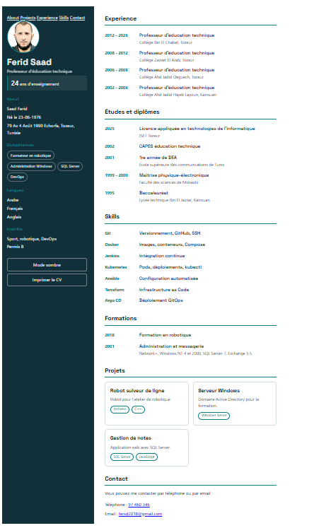

# III. Dockerisation initiale

## 10. Création d'un Dockerfile pour servir DevSecOps Portfolio avec Nginx

### Dockerfile avec commentaires

````
# FROM : image de départ sur laquelle on construit la nôtre
# - nginxinc/nginx-unprivileged : version officielle de Nginx qui ne tourne PAS en root
#   (si un attaquant compromet le serveur, il a très peu de droits)
# - 1.27-alpine : version fixée de Nginx (builds reproductibles, contrairement à "latest")
#   et base Alpine Linux, une distribution minuscule (moins de composants = moins de failles)
FROM nginxinc/nginx-unprivileged:1.27-alpine

# COPY : copie un fichier de votre ordinateur vers l'image
# Ici, votre nginx.conf remplace la configuration par défaut de Nginx
# (c'est le fichier avec le port 8080, les en-têtes de sécurité, le cache...)
COPY nginx.conf /etc/nginx/conf.d/default.conf

# Copie uniquement les 3 fichiers principaux du site dans le dossier servi par Nginx
# (le "/" final indique que la destination est un dossier)
# On évite "COPY . ." pour ne pas embarquer par erreur des fichiers inutiles ou sensibles
COPY index.html style.css script.js /usr/share/nginx/html/

# Copie le dossier images/ (photo de profil, etc.) vers le sous-dossier correspondant
# Il faut une ligne séparée : copier un dossier avec d'autres fichiers mélangerait leur contenu
COPY images/ /usr/share/nginx/html/images/

# EXPOSE : documente le port sur lequel le conteneur écoute (8080, comme dans nginx.conf)
# C'est une information : cela n'ouvre pas le port, c'est "-p 8080:8080" au lancement qui le fait
EXPOSE 8080

# HEALTHCHECK : Docker teste régulièrement que le site répond bien
#   --interval=30s : un test toutes les 30 secondes
#   --timeout=3s   : le test échoue s'il dure plus de 3 secondes
#   --retries=3    : après 3 échecs de suite, le conteneur est marqué "unhealthy"
# La commande testée :
#   wget -qO- http://localhost:8080/ : télécharge la page d'accueil en silence (-q)
#                                      et l'affiche sur la sortie (-O-) sans créer de fichier
#   || exit 1                        : si wget échoue, on signale l'échec à Docker
HEALTHCHECK --interval=30s --timeout=3s --retries=3 \
  CMD wget -qO- http://localhost:8080/ || exit 1

  ````

  ### 11. Construction d'une image Docker

  #### 11.1 Connexion SSH : 
````
  Redirection de ports :

Nom	Protocole	IP hôte	Port hôte	IP invité	Port invité
cv	TCP	127.0.0.1	8081	(vide)	8081
````
  ````
  Test-NetConnection 127.0.0.1 -Port 2222
ssh -p 2222 ferid@127.0.0.1
````
#### 11.2 Préparation de la VM Ubuntu: 
  ````
  sudo apt update
  docker --version
  ````


#### 11.3 Récupération du projet

````
git clone https://github.com/ferid-saad/TP1-Dep-App-CI-CD.git
cd TP1-Dep-App-CI-CD/cv-ferid-saad
git pull
````
#### 11.4 Construire l’image

````
sudo docker build -t cv-docker .
````
#### 11.5 Lancer le conteneur

````
sudo docker run -d --name cv -p 8081:8080 cv-docker
````
-d : en arrière-plan
--name cv : nom du conteneur
-p 8081:8080 : port 8081 de la VM vers le port 8080 du conteneur (8080 était déjà pris par Jenkins)

#### 11.6 Tester

````
sudo docker ps                  # le conteneur doit être "Up" puis "healthy"
sleep 5
curl -I http://localhost:8081   # doit répondre HTTP/1.1 200 OK, Server: nginx

  
````
## 12. Exécutiton du conteneur depuis la machine physique

http://192.168.100.88:8081
ou 
http://localhost:8081 

### Capture

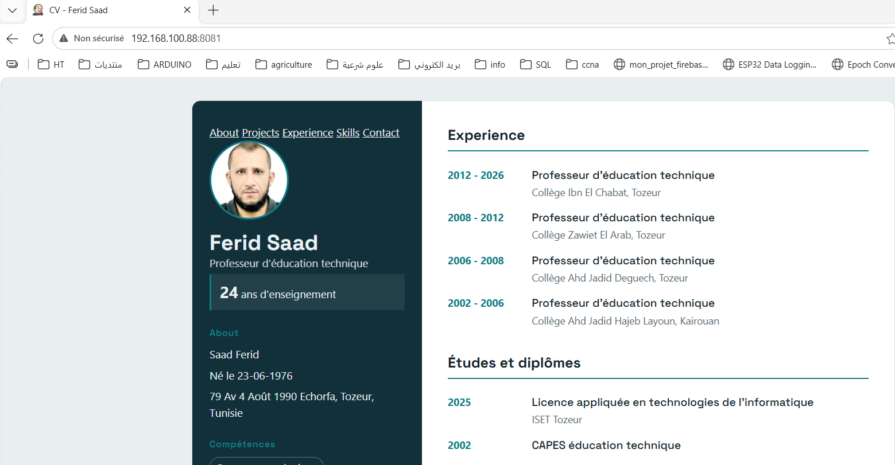

## 13. Déployez le Portfolio avec Docker Compose

````
services:
  cv:
    build: .
    image: cv-docker
    container_name: cv
    ports:
      - "8081:8080"
    restart: unless-stopped
    read_only: true
    tmpfs:
      - /tmp
    cap_drop:
      - ALL
    security_opt:
      - no-new-privileges:true
      ````
````
sudo docker compose up -d --build
sudo docker compose ps
sleep 5
curl -I http://localhost:8081


### Capture

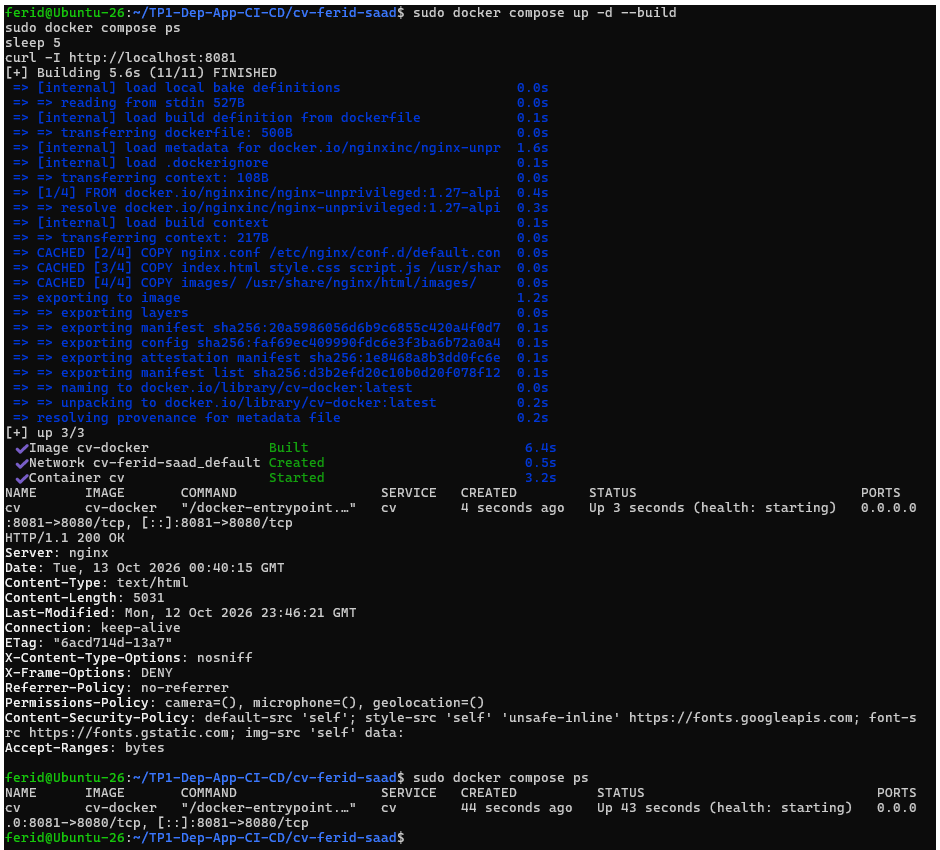